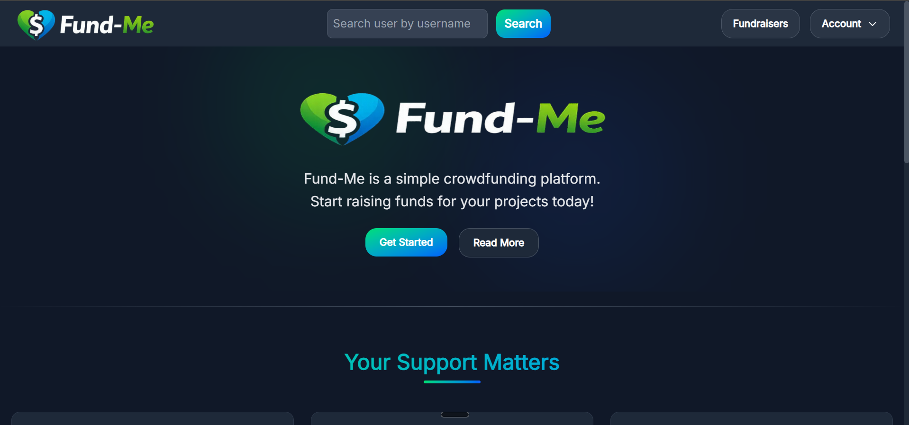

# Fund-Me

A creator support platform built with Next.js. Creators get a shareable profile page where fans can support them, and an earnings page to track what they have received.



**Live Demo:** [fundme-org.vercel.app](https://fundme-org.vercel.app)

## Features

- Creator profile page with a "Support the Creator" donation form
- Top 5 Supporters list with animated, polished styling
- Earnings page showing received payments and total earnings
- Copy-profile-link icon that turns into a checkmark after copying
- Sticky navbar that blurs on scroll, with a mobile dropdown menu
- Home page with an original introductory video
- Consistent dark theme with smooth animations

## Tech Stack

- **Framework:** Next.js (App Router)
- **Styling:** Tailwind CSS
- **Animations:** Framer Motion

## Getting Started

```bash
git clone https://github.com/saudus192/fund-me.git
cd fund-me
npm install
```

Copy the example file and add your own values:

```bash
cp .env.example .env.local
```

Then start the dev server:

```bash
    npm run dev
```

Open [http://localhost:3000](http://localhost:3000) in your browser.

## License

Released under the [MIT License](./LICENSE).

## Author

**Saud Usman**, web developer (MERN Stack, Next.js).
GitHub: [@saudus192](https://github.com/saudus192)
